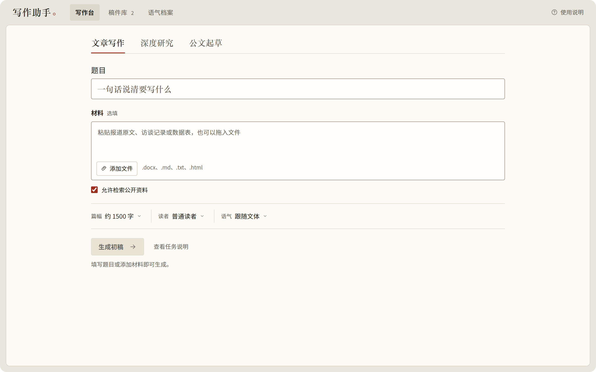
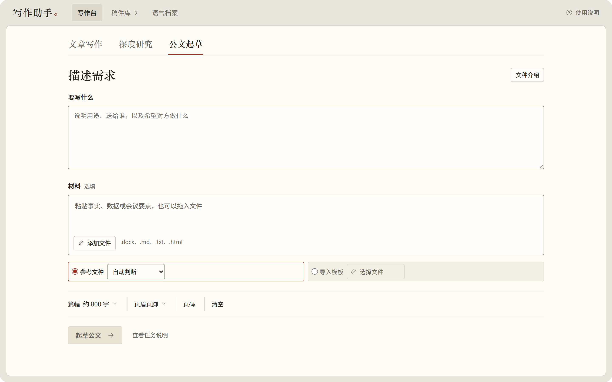

# 写作助手（dsh-writing-assistant）

公众号文章、公文起草与深度研究，三种写法共用同一个写作台：

- **公众号文章**：结合报道、访谈和公开数据，写出适合公众号阅读与传播的文章。标题、开头、段落节奏、引用方式都有成文规则，交付前过一遍「去 AI 味」自检。
- **公文起草**：按 GB/T 9704-2012 起草，保留 8 个文种，可机检并导出机关版式 Word。
- **深度研究**：围绕专题检索、比较、查证，先提纲后成文；关键事实要求两个独立来源，来源逐条可回查。

内置写作规则与信源搜寻规则：分析型先拆题、再列提纲、按证据写；研究型按证据缺口检索、原文回查、反例核对。写作台是侧栏里的一张「纸」——报头横排、纸面正文、朱红只用于动作；窄窗自动换布局，深色模式同样可用。

三种模式共用稿件库、分块编辑器、语气档案与 Word 导出。生成稿和导入稿都在同一个编辑器里改：点段落可手改、可让模型改、可撤回版本。



*写作台：文章写作 / 深度研究 / 公文起草三组，填题目与材料即可生成初稿。*

这是公开发行版，仓库与 npm 包中不含作者的任何本机数据、样稿或个人写作样本。

## 安装

要求 DSH `>=0.2.1-rc.2 <0.4.0`（见 `package.json` 的 `engines.dsh`）。写作助手是一个 bundle（Host 插件 + 侧栏页面），装完重启 DSH。

**方式一：插件管理**

在 DSH 的插件管理里用「安装 Bundle」，填入 npm 包名：

```
dsh-writing-assistant
```

**方式二：写进 profile 的 `package.json`**

```json
{
  "dependencies": {
    "dsh-writing-assistant": "^1.3.0"
  },
  "dsh": {
    "profile": {
      "bundles": ["dsh-writing-assistant"]
    }
  }
}
```

保存后重启 DSH，由 DSH 安装依赖并装配插件。装好后侧栏出现「写作助手」。

Word 导出、公文机检和 `.docx` 抽取在本机调用 Python：优先用 DSH 自带的 Python 运行时，找不到时退回 `PATH` 上的 `python` / `python3`。导出与机检只用标准库；抽取 `.docx` 正文需要 `python-docx`。

## 页面

| 路由 | 作用 |
|---|---|
| `#/write` | 写作台：文章写作 / 深度研究 / 公文起草 |
| `#/write?g=official` | 公文起草：默认「描述需求」，也可选参考文种或导入模板 |
| `#/works` | 稿件库：筛选、搜索、编辑、回收，可导入 Word 或 Markdown |
| `#/voice` | 语气档案：上传本人旧稿，提炼可观察的写作习惯 |
| `#/about` | 使用说明 |



*公文起草：默认「描述需求」，也可以选参考文种或导入模板。*

后台写作由 DSH 的 agent 在 Host 进程执行。任务保留原 ID、开始时间和已保存步骤；页面切换或重开后会按任务标识查回状态，DSH 重启后优先接回仍活跃的会话。宿主最多同时执行两条任务，多出的排队。

预览、稿件库和版本记录按正文汉字与西文词统计字数，标点、空格、Markdown 标记、链接地址和文末「参考资料」不计入。

## 数据与隐私

```
$DSH_HOME/writing-assistant/
  works/<id>/meta.json        稿件元信息
  works/<id>/draft.md         正文，唯一真相源
  works/<id>/revisions.jsonl  每次改动的记录
  voice/<名字>/profile.md     语气档案；samples/ 与 corpus.md 是素材
  exports/*.docx              导出的 Word
  doc-images/                 页眉页脚图片库
  workspace/                  后台 agent 的工作目录
```

没有 `DSH_HOME` 时，数据目录是 `~/.dsh/writing-assistant`。

- 稿件、档案、语料和图片只写本机，不上传任何地方。
- 提交写作或提炼任务时，页面里填写的内容、所选档案正文和样本文本会交给 DSH 当前配置的模型。
- 检索只使用公开资料。素材与档案不会作为检索关键词发送。

## 给模型的工具

| 工具 | 作用 |
|---|---|
| `writing_save_outline` | 分析型扩写前的提纲检查点：主线、每节判断、证据、预测条件 |
| `writing_save_work` | 把成稿存进稿库（`kind: article / official`） |
| `writing_patch_blocks` | 按块改稿，`blockId` + 哈希校验，对不上拒绝 |
| `writing_suggest_block` | 提交待采用建议，用户确认后才写进正文 |
| `writing_read_work` | 读稿件元信息、块清单与正文 |
| `writing_list` | 看稿库清单 |
| `writing_voice` | 语气档案：`show / save / note / use / list` |
| `writing_check` | 跑公文机检（章节、顺序、层级、红线、占位符） |

工具注册在根上，所有 agent preset 都能继承；在 Host 进程执行，直接写稿库，不要求模型去 shell 里写文件。

## 随包的 skill

| skill | 内容 |
|---|---|
| `research-writing` | 语料 → 语气档案、资料或描述 → 成文、预览选区改稿、交付前质量清单 |
| `official-document-drafting` | 8 个文种、GB/T 9704-2012 格式、导出 Word |

两个 skill 放在 `skills/` 里，随插件注册。若用户自己的 DSH 里装了同名 skill，那一份优先。

公文当前保留 8 个文种：通告、函、纪要、通报、情况专报、讲话稿、工作总结、危机处置报告。

## HTTP 接口

前缀 `/writing-assistant`，仅供页面与导出使用：

```
GET  /api/catalog                 目录：稿件、文种、语气档案、数据目录
GET  /api/works                   稿件列表
GET  /api/works/:id               稿件 + 块
POST /api/works/import|save|block|update|delete|revert
GET  /api/jobs  POST /api/jobs    后台任务
POST /api/jobs/cancel
POST /api/check                   公文机检
POST /api/export                  导出 Word
GET  /files/exports/:name         下载 docx
GET  /files/works/:id/:file       下载 draft.md / sources.md 等
GET/POST /api/voice…              语气档案
POST /api/extract                 .docx 抽正文
```

静态文件与文件接口都做 `realpath` 校验，拒绝 `..`、点文件和目录外链接；POST 只接受同源 JSON。

## 边界

- 导出的是**排版初稿**：红头、印章、发文机关标志与完整版记仍需本单位套版。字体只写名字、不嵌入，目标机器要装仿宋_GB2312、黑体、楷体_GB2312、方正小标宋，或用 `--font-preset` 换开源替代。
- 机检只做提示，最终以人工校对为准；正式发文、对外报送必须经有权限人员审核。
- 编辑粒度是「块」：跨块合并、块内局部替换都要以整块重写表达，一次请求覆盖一个连续选区。
- 文种固定为 8 个。用户点名的文种不在列表里时，应说明没有该模板，不要套用其他文种硬写。

## 目录

```
lib/                 Host 半边：路由、稿库、后台任务、工具、skill 注册
gallery/             侧栏页面（原生 JS + CSS，无构建步骤）
skills/              随包的 skill 与导出脚本
cordis.patch.yml     bundle 装配
icon.png             插件图标
```

改 `gallery/` 刷新页面即可；改 `lib/` 需要重启 DSH 才能装上新代码。

## 许可

插件代码 MIT。随包的 `official-document-drafting` 上游是 [zhaohui-yang/official-document-drafting](https://github.com/zhaohui-yang/official-document-drafting)（MIT），`research-writing/vendor/humanizer-zh` 上游是 [ai-zixun/humanizer-zh](https://github.com/ai-zixun/humanizer-zh)（MIT），两者的版权与许可声明随目录保留。
